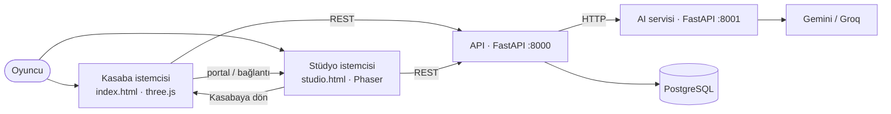
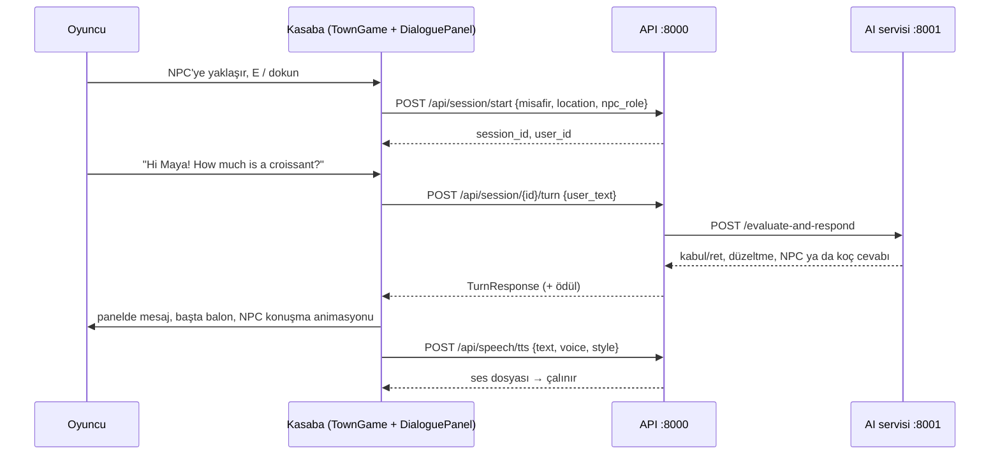

# Praglish Mimari Belgesi

Son güncelleme: 12 Ekim 2026 · Repo: [Zehrayt/roleApp](https://github.com/Zehrayt/roleApp) · Dal: `main`

> roleApp, praglish projesinin (`main`, 12 Ekim 2026) kodundan geçmişsiz olarak başlatılmış devamıdır. praglish reposunda değişiklik yapılmaz.

Bu dosya projenin **yaşayan mimari kaydıdır**: sistemin bugün nasıl çalıştığını, neyin yapıldığını, neyin yapılacağını ve hangi kararın neden alındığını tek yerde tutar. Ürün ve oyun tasarımının ayrıntıları `docs/roleApp.md` belgesindedir (özellikle Bölüm III, 31–37). İkisi çelişirse kod ve bu dosya güncellenir, sonra roleApp.md düzeltilir.

**Nasıl güncellenir:** Bir iş bitince "Durum" tablosunda işaretini değiştir ve tarihi yaz. Yeni bir mimari karar alınca "Karar kaydı"na bir satır ekle. Yeni bir mekân ya da NPC eklerken "Şablonlar" bölümündeki kontrol listesini kopyala.

---

## 1. Özet

Praglish, İngilizce öğrenmeyi bir kasabada yaşamaya dönüştüren bir oyundur. Oyuncu blok (voxel) tabanlı 3B bir kasabada dolaşır, binalara girer ve oradaki NPC'lerle İngilizce konuşur. Her cümlesi backend'de değerlendirilir, düzeltilir ve ödüllendirilir.

| Katman | Teknoloji | Klasör |
| --- | --- | --- |
| Kasaba istemcisi (hub) | three.js + TypeScript + Vite | `game/src/town/`, `game/index.html` |
| Eski modlar (geçici) | Phaser 3 + TypeScript | `game/src/scenes/`, `game/studio.html` |
| API | Python, FastAPI, SQLAlchemy | `api/` (port 8000) |
| AI servisi | Python, FastAPI, Gemini / Groq | `ai/` (port 8001) |
| Paylaşılan şemalar | Pydantic | `shared/` |
| Veritabanı | PostgreSQL 16 | `docker-compose.yml` → `db` |

---

## 2. Durum

### 2.1 Yapılanlar

| ✓ | İş | Tarih | Nerede |
| --- | --- | --- | --- |
| ✓ | roleApp reposu kuruldu: praglish kodu + blok kasaba, temiz geçmişle | 12.10.2026 | bu repo |
| ✓ | Blok dünya kararı ve tek dosyalık prototip | 12.10.2026 | `game/prototypes/blok-kasaba/` |
| ✓ | Kasaba istemcisi: blok dünya, özgün 16 px dokular, mesh üretimi, kesit görünüm | 12.10.2026 | `game/src/town/` |
| ✓ | İzometrik / perspektif kamera, 90° dönme, zoom, takip | 12.10.2026 | `CameraRig.ts` |
| ✓ | Dokun-git (A*, mevcut `PathFinder.ts`), WASD, NPC'ye dokununca yanına yürüme | 12.10.2026 | `TownGame.ts` |
| ✓ | Kutu karakterler, yürüme ve konuşma animasyonu | 12.10.2026 | `BlockCharacter.ts` |
| ✓ | 3 NPC backend'e bağlı: Maya (fırın), Lina (kütüphane), Leo (kafe) | 12.10.2026 | `DialoguePanel.ts`, `townMap.ts` |
| ✓ | Konuşma: yazılı tur, mikrofon (STT), seslendirme (TTS), düzeltme, koç, XP/jeton | 12.10.2026 | `DialoguePanel.ts` |
| ✓ | NPC cevabı başının üstünde balonla görünür | 12.10.2026 | `TownGame.ts` |
| ✓ | Kafe senaryosu etkin, Leo AI profili, barista TTS sesi | 12.10.2026 | `ai/main.py`, `api/game_data/scenarios/cafe.json`, `PraglishApiClient.ts` |
| ✓ | İki sayfa: kasaba (`index.html`) + Phaser modları (`studio.html?scene=`), portal ve geri dönüş bağlantısı | 12.10.2026 | `game/`, `src/main.ts`, `vite.config.ts` |
| ✓ | Birim testleri: dünya, mesher, harita erişilebilirliği, NPC/senaryo eşleşmesi, kelime nesneleri (15 test) | 12.10.2026 | `src/town/__tests__/town.test.ts` |
| ✓ | Kelime nesneleri: 9 nesneye dokun / `F` → "Bu İngilizcede ne?" paneli, Türkçe ipucu, jeton, ilerleme; vurgulama çerçevesi | 12.10.2026 | `VocabPanel.ts`, `townMap.ts` (`props`), `api/game_data/vocabulary/*.json` |
| ✓ | Kafe için sahte AI cevabı (`USE_MOCK_AI=true` iken Leo da cevap verir) | 12.10.2026 | `api/services/ai_client.py` |
| ✓ | Spell Book (MVP): ham kelime olayları (`word_events`), roleApp 4.2 formülüyle zorlanma puanı ve durum, `GET /api/spellbook/{user_id}`, kasabada "Büyü Kitabı" çekmecesi (`B`), süzgeçler | 12.10.2026 | `api/services/spell_book.py`, `word_events.py`, `routes/spellbook.py`, `SpellBookPanel.ts` |
| ✓ | Sahte API (`npm run dev:mock-api`): gerçek kelime listeleri, ilerleme ve Spell Book uçları | 12.10.2026 | `game/scripts/mock-api.mjs` |
| ✓ | Kesit yüksekliği 3'e indirildi (duvar dibindeki eşyalar görünür); kapalı panelin klavyeyi yutması düzeltildi | 12.10.2026 | `townMap.ts`, `*Panel.ts`, `town.css` |
| ✓ | roleApp belgesi Sürüm 4'e güncellendi | 12.10.2026 | `docs/roleApp.md` |

### 2.2 Yapılacaklar

Öncelik sırasına göre. **Faz** sütunu roleApp 37'deki fazlardır.

| ☐ | İş | Faz | Not |
| --- | --- | --- | --- |
| ☐ | `cd game && npm install` → `package-lock.json`'u commitle (three eklendi) | 0 | Bu yapılmadan Docker'daki `npm ci` hata verir |
| ☐ | Docker ile uçtan uca deneme: gerçek AI anahtarıyla üç NPC'yle konuşma | 0 | |
| ☐ | Spell Book 2. adım: kırmızı kelimeleri NPC cevaplarına enjekte etmek (roleApp 4.5), SRS tekrarı (4.4), `mastered` durumu, telaffuz ve okuma olayları | 1 | Puan ve uç hazır; AI servisinin NPC prompt'una `red` kelimeler eklenecek |
| ☐ | Backend testlerini Docker'da çalıştır: `docker compose run --rm api python -m unittest discover tests` | 0 | Spell Book formül testleri bu ortamda geçti; veritabanı katmanı henüz çalıştırılmadı |
| ☐ | Harita JSON'a taşınır, editör kararı (MagicaVoxel içe aktarma mı, oyun içi editör mü) | 1 | roleApp 33.4 |
| ☐ | Mobil: Capacitor, iki parmakla zoom, orta segment telefonda FPS ölçümü | 1 | roleApp 33.7, 36 |
| ☐ | Dublaj Stüdyosu kasabaya taşınır | 2 | Sonra `DubScene` silinir |
| ☐ | Gelişim Defteri kasabaya taşınır | 2 | Sonra `DashboardScene` silinir |
| ☐ | Phaser ve eski izometrik kodun kaldırılması (`IsometricMath`, `DepthSort`, `IsoAvatar`, Tiled haritaları, `RoomScene`, `LibraryScene`, `MenuScene`) | 2 | Son mod taşınınca |
| ☐ | NPC duygu yüzleri (5 kademe), gün döngüsü, NPC'lerin saatlere göre yer değiştirmesi | 2 | roleApp 3.1, 5.5 |
| ☐ | Agentic NPC'ler: LLM kararıyla yürüme, NPC'ler arası konuşma | 3 | roleApp 7, 28 |
| ☐ | Kalıcı konuşma geçmişi (bugün yalnızca sayfa belleğinde) | 1 | Backend'de diyalog geçmişi servisi var (`api/services/dialogue_history.py`); istemci için okuma ucu gerekir |

---

## 3. Sistem bağlamı



Kural: istemci oyun kararı vermez (değerlendirme, ödül, senaryo durumu backend'dedir). İstemci dünyayı çizer, hareketi yönetir ve backend'e cümle gönderir.

---

## 4. Bileşenler

### 4.1 Kasaba istemcisi (`game/src/town/`)

| Modül | Ne yapar | three.js'e bağlı mı | Testli mi |
| --- | --- | --- | --- |
| `blocks.ts` | Blok kataloğu, doku indeksleri | Hayır | Dolaylı |
| `VoxelWorld.ts` | Blok ızgarası, `isStandable` | Hayır | Evet |
| `townMap.ts` | Kasabanın tanımı: yollar, binalar, ağaçlar, NPC'ler, portallar | Hayır | Evet |
| `mesher.ts` | Bloklardan bölge başına üçgen verisi (yüz eleme, köşe AO) | Hayır | Evet |
| `textures.ts` | 16×16 doku atlası ve karakter yüzleri (canvas) | Hayır | Hayır |
| `BlockCharacter.ts` | Kutu karakter, animasyon | Evet | Hayır |
| `CameraRig.ts` | Kamera modları, dönme, zoom, takip | Evet | Hayır |
| `DialoguePanel.ts` | NPC konuşma paneli ve backend çağrıları | Hayır (DOM) | Hayır |
| `VocabPanel.ts` | Kelime nesnesi paneli (`/api/vocabulary/*`) | Hayır (DOM) | Tarayıcıda denendi |
| `SpellBookPanel.ts` | Büyü Kitabı çekmecesi (`/api/spellbook/*`) | Hayır (DOM) | Tarayıcıda denendi |
| `TownGame.ts` | Her şeyi birleştiren oyun döngüsü | Evet | Hayır |
| `main.ts`, `town.css` | Giriş noktası ve HUD stilleri | — | — |

Paylaşılan: `engine/PathFinder.ts` (A*), `services/PraglishApiClient.ts` (API istemcisi), `services/RoleplayMemory.ts` (mekân başına konuşma geçmişi).

### 4.2 Backend

| Bileşen | Sorumluluk | Dosya |
| --- | --- | --- |
| Oturum | Misafir kullanıcı ve oyun oturumu oluşturur | `api/routes/session.py` |
| Tur | Cümleyi AI servisine gönderir, senaryo durumunu ve ödülü günceller | `api/routes/turn.py`, `api/services/*` |
| Ses | STT ve TTS isteklerini AI servisine iletir | `api/routes/speech.py` |
| Kelime | Nesne-kelime eşleştirme ve ilerleme; Spell Book'a olay yazar | `api/routes/vocabulary.py` |
| Spell Book | Kelime olaylarından zorlanma puanı ve durum hesaplar | `api/services/spell_book.py` (saf), `api/services/word_events.py`, `api/routes/spellbook.py` |
| Analitik | Gelişim defteri verisi | `api/routes/analytics.py` |
| AI servisi | Değerlendirme + NPC cevabı, düzeltme, STT, TTS, çıkarım | `ai/main.py`, `ai/modules/*` |
| Senaryolar | Mekân başına hedef alanlar ve ödüller | `api/game_data/scenarios/*.json` |

---

## 5. Veri akışı: bir NPC konuşma turu



Mikrofon: kayıt → `POST /api/speech/stt` → dönen metin aynı tur akışına girer.

---

## 6. Sözleşmeler

### 6.1 İstemcinin kullandığı API uçları

| Uç | Gövde | Dönüş |
| --- | --- | --- |
| `POST /api/session/start` | `username, password, location, npc_role` | `session_id, user_id` |
| `POST /api/session/{id}/turn` | `user_text` | `accepted, correction, npc_response, response_speaker, rewards…` |
| `POST /api/speech/stt` | form-data `audio` | `text, language_code` |
| `POST /api/speech/tts` | `text, voice, style` | ses (blob) |
| `POST /api/vocabulary/submit`, `GET /api/vocabulary/progress/{user}/{location}` | kelime | eşleşme, ilerleme |
| `POST /api/analytics/dashboard` | misafir kimliği | gelişim verisi |
| `GET /api/spellbook/{user_id}` | — | kelime listesi: `lemma, status, struggle_score, *_fails, active_successes, sources, example` |

### 6.1.1 Spell Book olay kaynakları

| Nerede | Olay | Ağırlık |
| --- | --- | --- |
| Kelime nesnesi: yanlış cevap | Kavramın ana kelimesine `meaning_fail` | +25 |
| Kelime nesnesi: doğru cevap | Söylenen kelimeye `active_success` | −15 |
| NPC turu kabul (çıkarım) | Cümledeki isim/sıfatlara `active_success`, örnek cümle saklanır | −15 |
| NPC turu ret (çıkarım) | Hatalı kelimeye `usage_fail` (anlam/kelime seçimi hatasında `meaning_fail`); cümle saklanmaz | +15 / +25 |

Puan: olayların ağırlığı 14 günlük yarılanmayla azalır, 0–100 arasına sıkıştırılır. ≥ 60 kırmızı, 30–60 sarı, < 30 ve ≥ 2 başarı yeşil, diğerleri yeni.

API adresi: `localhost`'ta `http://localhost:8000`, aksi halde `https://praglish-api.onrender.com` (`index.html` ve `studio.html` içindeki küçük betik).

### 6.2 NPC eşlemesi

| NPC | Bina | `location` | `npc_role` | Ses profili |
| --- | --- | --- | --- | --- |
| Maya | Fırın | `bakery` | `baker` | `cafeNpc` |
| Lina | Kütüphane | `library` | `librarian` | `librarian` |
| Leo | Dinleme Köşesi | `cafe` | `barista` | `barista` |

Bir NPC'nin çalışması için dört yerin uyuşması gerekir: `townMap.ts` kaydı, `scenarios/<location>.json`, `ai/main.py` → `NPC_PROFILES`, ses profili. Birim testi `location/npc_role` listesini kontrol eder.

### 6.3 Blok dünya

1 blok = 1 m. Zemin y = 1, karakter y = 2'de durur ve iki boş blok ister. Kesit eşiği y ≥ 3. Kelime nesneleri (`props`) blok listesi + `location` + `concept` taşır; kavram ilgili kelime dosyasında olmak zorundadır (test kontrol eder). Ayrıntı: roleApp 33.

### 6.4 Sayfalar arası bağlantı

`studio.html?scene=<DubScene|DashboardScene|MenuScene|LibraryScene|RoomScene>` istenen Phaser sahnesini açar. Kasabadaki portallar `townMap.ts` içinde `portal.href` ile tanımlanır.

---

## 7. Karar kaydı

| No | Tarih | Karar | Neden | Durum |
| --- | --- | --- | --- | --- |
| K-001 | 12.10.2026 | Hub, blok (voxel) dünya olarak three.js ile yapılır; varsayılan kamera ortografik izometrik | Asset ölçeği, derinlik sıralaması ve 8 yönlü sprite sorunlarını ortadan kaldırır; kamera döner | Kabul |
| K-002 | 12.10.2026 | Yandan görünüm kasaba ve ona bağlı fizik/iskelet motoru (Möbius) roleApp için kullanılmaz | Blok dünya seçildi | Kabul |
| K-003 | 12.10.2026 | Dokular özgündür; Minecraft dokuları, isimleri ve logoları kullanılmaz | Mojang kullanım kuralları | Kabul |
| K-004 | 12.10.2026 | Phaser modları bir kerede atılmaz; `studio.html`'de çalışır, portal ile bağlanır, sırayla taşınır | Çalışan özellikleri kırmadan geçiş | Kabul |
| K-005 | 12.10.2026 | NPC konuşmaları mevcut `/api/session` tur akışını kullanır; yeni backend ucu açılmaz | Değerlendirme, ödül ve senaryo mantığı zaten orada | Kabul |
| K-006 | 12.10.2026 | Dünya mantığı (blok, harita, mesh verisi, yol bulma) three.js'ten bağımsız tutulur | Tarayıcısız test, ileride sunucuya taşınabilirlik | Kabul |
| K-007 | — | Harita düzenleme yöntemi (MagicaVoxel içe aktarma / oyun içi editör) | | Açık |

Yeni karar satırı şablonu: `| K-00X | GG.AA.YYYY | Karar | Neden | Kabul / Açık / Değiştirildi (K-00Y) |`

---

## 8. Çalıştırma ve test

```bash
# İlk sefer (three bağımlılığı eklendi)
cd game && npm install

# Her şey Docker'da (db, ai, api, game)
docker compose up --build        # http://localhost:5173 → kasaba

# Yalnızca istemci
cd game && npm run dev           # http://localhost:5173 kasaba, /studio.html Phaser modları
npm run dev:mock-api             # backend olmadan arayüz denemesi
npm test                         # vitest (kasaba testleri dahil)
npm run typecheck
```

Kontroller: dokun/tıkla = yürü · `E` / `Enter` = konuş / gir · `F` = kelime nesnesi · `B` = Büyü Kitabı · `Q` / `R` = kamerayı döndür · tekerlek, `+` / `-` = zoom · `WASD` / oklar = adım · `Esc` = paneli kapat.

---

## 9. Şablonlar

### 9.1 Yeni mekân (bina) ekleme

- [ ] `townMap.ts` → `placeBuilding(...)` (konum, duvar/çatı/zemin bloğu, kapı, pencereler) ve iç eşyalar
- [ ] Kapıdan ana yola `COBBLE` yolu
- [ ] Ağaçların ve diğer binaların kesit kutusuna (`isUpperBlock`) girmediğini kontrol et
- [ ] Mekân bir Phaser modu açacaksa `portal: { label, href }`
- [ ] Testler: kapıya yol var mı, her blok tek bölgede mi
- [ ] roleApp 3.2'deki mekân tablosu ve bu dosyanın "Durum" bölümü

### 9.2 Yeni NPC ekleme

- [ ] `api/game_data/scenarios/<location>.json` (`status: "active"`)
- [ ] `ai/main.py` → `NPC_PROFILES[(location, npc_role)]`
- [ ] Gerekirse `PraglishApiClient.ts` → `ROLEPLAY_TTS_PROFILES` ve `townMap.ts` → `NpcVoice`
- [ ] `townMap.ts` → `npcs` (hücre, bina, selam cümlesi, görünüş)
- [ ] Testteki `location/npc_role` listesini güncelle
- [ ] 6.2'deki tabloya satır ekle

### 9.3 Yeni kelime nesnesi ekleme

- [ ] Nesneyi bloklarla kur (`townMap.ts`, bina içinde)
- [ ] `api/game_data/vocabulary/<location>.json`'da kavram yoksa ekle (kelime + eş anlamlılar, `reward_coins`)
- [ ] `townMap.ts` → `props` dizisine kayıt: `id`, `buildingId`, `location`, `concept`, `nameTr`, `blocks`
- [ ] Testler: bloklar dolu ve binada mı, yanına yürünebiliyor mu, kavram kelime dosyasında var mı

### 9.4 Bir Phaser modunu kasabaya taşıma

- [ ] Modun mantığını Phaser'dan bağımsız bir modüle ayır (DOM panel + servis çağrıları)
- [ ] Kasabada karşılık gelen binayı ya da nesneyi ekle, portalı kaldır
- [ ] Eski sahneyi `src/main.ts` listesinden ve `src/scenes/`'den sil
- [ ] Karar kaydına ve "Durum" tablosuna işle

---

## 10. Bilinen sınırlar ve riskler

| Konu | Durum | Önlem |
| --- | --- | --- |
| `package-lock.json` three içermiyor | Docker `npm ci` başarısız olur | `npm install` sonrası lock dosyasını commitle |
| Konuşma geçmişi yalnızca sayfa belleğinde | Sayfa yenilenince panel boşalır (backend kaydı durur) | Geçmiş okuma ucu (2.2) |
| Karakter çizim çağrıları NPC sayısıyla artar | 3 NPC'de sorun yok | 15+ NPC'de instancing (roleApp 33.7) |
| Harita kodda tanımlı | Tasarımcı düzenleyemez | JSON + editör (K-007) |
| TTS anahtarı yoksa ses çıkmaz | Metin yine görünür | Bilinçli; hata sessizce yutulur |
| Mobil performans ölçülmedi | Masaüstünde akıcı | Faz 1 ölçümü |
